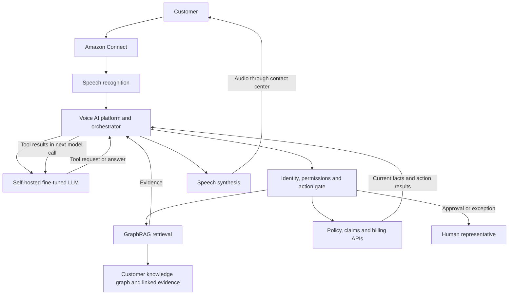

# Insurance Contact Center — Architecture and Governance

An illustrative solution-design case for insurance servicing. Architecture choices are proposed; no production results are claimed.

## Architecture

## Component responsibilities

| Component | Responsibility |
|---|---|
| CCaaS | Call transport, queues, routing and human transfer |
| Voice AI platform, e.g. Yellow.ai | Conversation runtime, speech integration and handoff |
| Orchestrator | Session state, model calls, authorized tool execution and recovery |
| LLM | Interpret requests, request tools and generate grounded responses |
| GraphRAG | Retrieve related customer records and supporting evidence |
| Core-system APIs | Retrieve current facts and execute permitted transactions |
| Human representative | Review, authorization, exception resolution and takeover |

The design uses one conversational agent with domain tools. Separate systems do not require separate autonomous agents.

## Live conversation

1. Receive the call and transcribe speech.
2. Send the text, instructions, context and allowed tool schemas to the model.
3. Verify identity and scope access before protected retrieval.
4. Execute authorized graph retrieval or source-system API calls.
5. Return evidence to the model as a tool response.
6. Check the generated answer and convert it to speech.
7. Transfer with context when the customer requests help or policy requires it.

## Model adaptation

- Evaluate the base model first and identify persistent behavior gaps.
- Prepare de-identified, expert-reviewed input/output examples.
- Keep related conversations and duplicates within the same train, validation or test split.
- Apply supervised fine-tuning using QLoRA where GPU memory constraints justify it.
- Consider RLHF only for a justified preference-alignment need. Human review alone is not RLHF.
- Release only after independent evaluation. Live customer facts remain in source systems.

## Evaluation

| Layer | Evaluation focus |
|---|---|
| Speech | Transcription accuracy across required languages and accents |
| Intent and extraction | Correct journey and required fields |
| Retrieval | Required-fact recall, scope isolation and source support |
| Generation | Grounding, completeness and unsupported claims |
| Tools and workflow | Correct actions, consent, approvals and duplicate prevention |
| End-to-end | Resolution, handoff quality, latency, cost and customer effort |

Use expert-reviewed cases, negative tests, regression suites and held-out evaluation. Compare baseline and candidate versions by journey and language. Establish release thresholds with accountable owners rather than inventing improvement figures.

## AI governance

- Assign journey, product, data, model, risk and incident owners.
- Define purpose, eligible populations, exclusions and action boundaries.
- Enforce customer-scoped access, data minimization, retention and approved data flows.
- Keep customer consent distinct from staff authorization.
- Version models, prompts, adapters, ontologies, retrieval indexes, workflows and tools.
- Require proportional assurance and approval for material changes.
- Preserve audit evidence and support constrain, suspend, rollback and reauthorization decisions.

## Earned autonomy

| Level | Operating model |
|---|---|
| 1 | Human-first, limited AI support |
| 2 | Human-led with substantial AI assistance |
| 3 | AI-led, with planned human authorization |
| 4 | Autonomous within explicitly approved boundaries |

Assign authority to a bounded journey variant, not to the whole chatbot. Enforce the decision in backend controls.

## Monitoring and observability

Propagate correlation IDs across call, speech, model, retrieval and API spans. Record version identifiers, timings and outcomes with redaction and access controls.

Monitor latency percentiles, errors, timeouts, concurrency, resource use, token cost, grounding quality, handoff rates and repeat contacts. Pair alerts with owners and runbooks. Use traces to diagnose failures and safe fallbacks or rollback to recover.

Do not store unrestricted prompts, recordings or payment details merely for debugging. Reviewed feedback can produce regression tests or curated training examples.

## Delivery plan

| Phase | Work | Outputs |
|---|---|---|
| Weeks 1–3 | Confirm use cases, audit data, baseline KPIs and agree owners/integrations | Charter, baseline, readiness assessment |
| Weeks 4–8 | Build flows, retrieval, integrations and context handoff; run UAT | Tested application and approved release |
| Weeks 9–12 | Controlled launch, weekly value tracking and review | Performance evidence and scale recommendation |

Scope and readiness determine the schedule. Fine-tuning and preference training require explicit effort and evaluation planning.

## Interactive version

[Download the interactive HTML](../../public/insurance-contact-center/index.html). GitHub displays its source; download the raw file and open it locally. When the repository application runs, it serves the explorer at `/insurance-contact-center/`.
